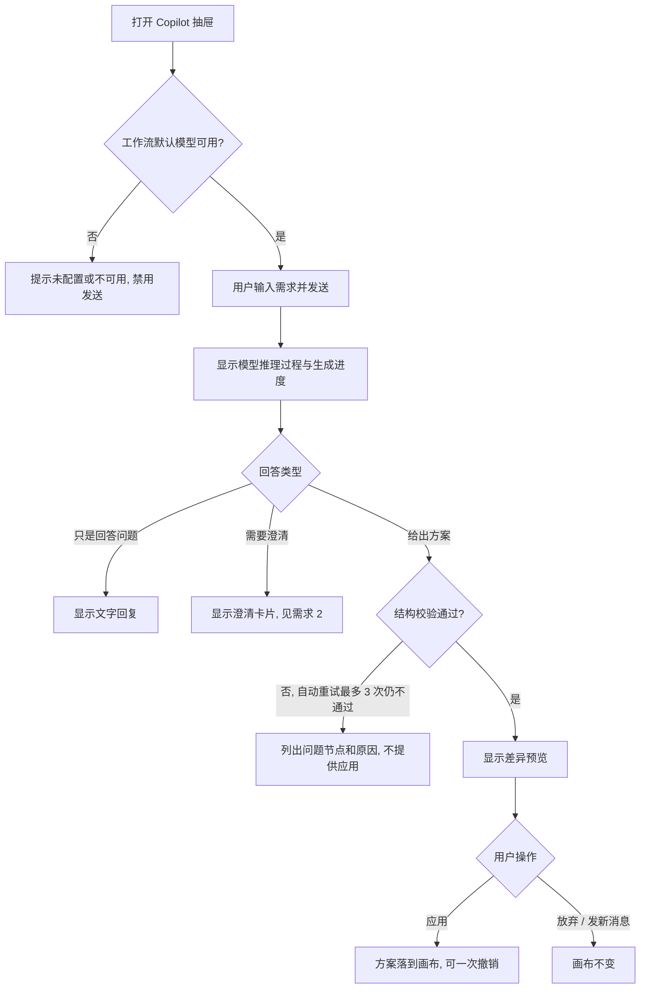
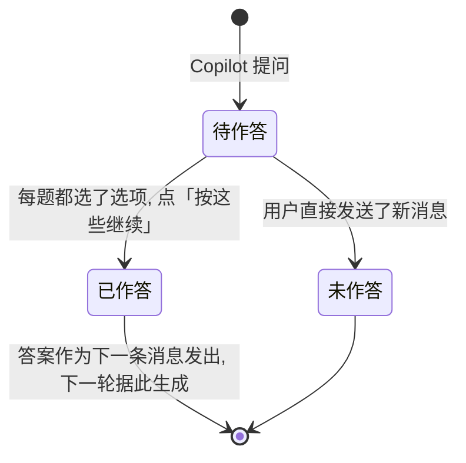

# 变更日志

| 时间 | 主要变更内容 |
| --- | --- |
| 11.23 | 工作流编辑页 Copilot 需求确认（规格与设计） |
| 11.25 | 补充 Copilot 生成质量方案（先问再做、说清做不到、离线评测集）；补充画布自动布局 |
| 11.26 | 浏览器实测后补充：节点默认折叠、条件与输出节点可折叠、保存不清空对话；四项需求开发完成并合入 3.1.0-beta1 开发线 |

# 一、需求背景介绍

**工作流编辑页 Copilot**（内部规划）：搭一条工作流要先熟悉 12 类节点及各自的参数，新手很难一次搭对；改一条已有工作流时，也只能逐个节点手动调整。本期在工作流编辑页加一个 Copilot 抽屉，用户用自然语言描述需求，Copilot 给出一份工作流方案，用户看清改动后再决定是否应用到画布。

**Copilot 生成质量**（内部规划，来自 Copilot 试用反馈）：试用中，用户让 Copilot 做「报销助手」，再用「报销 claude code 500$ 研发用」测试，结果有三处不对：需求没提币种，Copilot 把 500 美元当成 500 元处理；「超过 500 走审批」被理解为不含 500，而且没告诉用户；平台没有审批节点，Copilot 只输出一句提示，既没说明做不到，也没用平台现有的发送邮件等工具。本期让 Copilot 在关键点没说清时先问，方案里写明自己做的假设，做不到的地方说清楚并给出替代做法，并用一套评测集证明效果。

**画布自动布局与节点折叠**（内部规划，来自 Copilot 试用反馈）：Copilot 一次可能新增十几个节点，节点展开后很长，画布很快变得杂乱。本期提供一键自动布局，生成的节点默认折叠，用户折叠或展开节点后画布自动重新排列。

# 二、目标及优先级

本版本做三件事：用户能在编辑页用一句话生成或修改工作流，并在应用前看清改动；Copilot 在关键点不清时先问、做不到时说清楚；生成的工作流在画布上整齐、紧凑、可读。另修复一个管理视角下新建工作流报错的缺陷。

| 需求 | 目标 | 优先级 |
| --- | --- | --- |
| 工作流编辑页 Copilot | 有编辑权限的用户在编辑页用自然语言生成或修改工作流；方案应用前展示差异，应用后一次撤销即可恢复；方案均能通过工作流结构校验 | P1 |
| Copilot 生成质量 | 在内部评测集上：「应先问」用例的提问命中率 ≥ 80%；「需求清楚」用例的误问率 ≤ 20%；「平台做不到」用例的明确说明率 ≥ 75%；结构校验通过率不低于改动前 | P1 |
| 画布自动布局与节点折叠 | 一键自动布局后节点无重叠；Copilot 新增的节点默认折叠；折叠或展开节点后画布自动重排，可撤销 | P1 |

# 三、功能详细说明

## 1. 工作流编辑页 Copilot

### (1) 需求概述

Copilot 是工作流编辑页画布右侧的一个抽屉：用户用自然语言提需求，Copilot 返回一份工作流方案；方案以「相对当前画布的差异」展示，用户点「应用」后才落到画布。本需求分四块：入口与可用性、生成与修改、资源填写、差异预览与应用。

### (2) 术语

| 术语 | 定义 |
| --- | --- |
| Copilot | 工作流编辑页右侧的对话抽屉，根据用户的自然语言需求产出工作流方案 |
| 方案 | Copilot 一轮回答中给出的工作流修改结果，未应用前不影响画布 |
| 差异预览 | 方案相对发送时画布的改动清单：新增、删除、改动的节点和连线 |
| 应用 | 用户确认后把方案落到画布的动作；不保存工作流 |
| 工作流默认模型 | 系统模型配置中「工作流」一项设置的模型，Copilot 固定使用它 |

### (3) 目标

用户无需熟悉节点参数即可得到能通过平台结构校验的第一版工作流；修改已有工作流时，用户需求没提到的节点、参数和位置保持不变。

### (4) 需求内容

**入口与页面**：编辑页顶栏增加「Copilot」按钮，点击后在画布右侧打开抽屉（宽 440 像素），画布相应变窄，顶栏按钮不被遮挡。抽屉与「测试运行」面板互斥：打开其中一个时自动收起另一个。输入区复用平台对话组件，生成过程中显示停止按钮。

**用户流程**：

主流程文字说明：用户发送需求后，抽屉先显示模型的推理过程，再显示方案；方案通过平台结构校验后展示差异预览；用户点「应用」，改动落到画布，按 Ctrl+Z 一次即可恢复到应用前。画布为空时生成整条工作流；画布已有内容时，以发送那一刻的画布（含未保存的手动改动）为基础修改。同一次打开期间，前面的对话会作为后续轮次的上下文。

**字段与规则**：

| 字段名称 | 来源 | 展示规则 | 交互动作 | 限制条件 |
| --- | --- | --- | --- | --- |
| 需求输入 | 用户输入 | 抽屉底部输入框 | 回车或点发送 | 对话超过 40 条或合计超过 60 000 字时拒绝，提示开启新对话 |
| 推理过程 | 模型返回 | 可折叠框，生成中展开，结束后折叠 | 点击展开或折叠 | 无 |
| 差异预览 | 系统生成 | 列出新增、删除、改动的节点（改动项显示「旧值 → 新值」）和新增、删除的连线；未改动内容不列 | 「应用」「放弃」 | 校验不通过时不显示「应用」 |
| 需要你选 | 系统生成 | 差异预览中标出无法唯一确定的模型、知识库、工具 | 应用后由用户在节点上选择 | 只在当前用户有权使用的资源中匹配 |
| 新对话 | 系统 | 对话非空时显示在输入框上方 | 清空当前对话 | 生成中不可用 |

**资源填写规则**：需要模型的节点默认填工作流默认模型；用户在需求里点名的模型若能在其可用模型中唯一匹配，则填该模型。Agent 节点与平台导入工作流的做法一致，默认填助手默认模型。知识库和工具只在当前用户有权使用的范围内按名称匹配；唯一匹配则填入，无匹配或多个候选则留空并标「需要你选」。方案中出现当前用户无权使用或不存在的资源时，一律清空并标「需要你选」。工具节点例外：找不到对应工具时该节点不加入方案，差异预览中提示用户从节点面板拖入。

**状态与流转**：一轮回答的状态为「生成中 → 已给出方案 / 已提问 / 文字回复 / 失败 / 已停止」；方案的状态为「待处理 → 已应用 / 已放弃」。应用后差异预览下方显示「已应用到画布，可按 Ctrl+Z 撤销」。

**异常与边界**：

| 情况 | 处理 |
| --- | --- |
| 未配置工作流默认模型 | 抽屉内提示「未配置工作流默认模型，请管理员在『系统模型配置 → 工作流』中设置」，禁用发送（错误码 10560） |
| 工作流默认模型已删除或停用 | 提示该模型已删除或已停用及重新设置的指引，禁用发送（10561） |
| 画布或对话过长（画布超过 500 个节点或 2 000 条连线，画布声明超过 60 000 字，对话超过 40 条或 60 000 字） | 拒绝本轮并提示缩短或开启新对话，不只基于部分画布产出方案（10562） |
| 模型调用失败或超时（首个输出 180 秒内未到、之后连续 60 秒无输出、整轮超过 600 秒） | 本轮显示失败及可读原因，画布不变，用户可直接重发（10563） |
| 方案 3 次都没通过结构校验 | 不提供「应用」，逐条列出问题节点名和原因，不显示原始报错 |
| 用户点「停止」 | 终止本轮，不产出方案，画布不变；已收到的方案仍可应用 |
| 发送后、应用前用户又手动改了画布 | 应用前弹窗确认「发送之后你在画布上做的改动会被这个方案覆盖」，取消则画布不变 |
| 用户点顶栏「保存」 | 对话和抽屉状态保留，进行中的一轮继续 |
| 刷新页面、离开编辑页或打开另一条工作流 | 清空对话，中止进行中的一轮 |
| 平台关闭了代码节点 | 方案中不出现代码节点；用户明确要求时说明该能力已关闭 |
| 用户的消息不是生成或修改请求 | 只回复文字，不产出方案 |

**权限**：只有对当前工作流有编辑权限的用户能看到并使用 Copilot；绕过页面直接调用接口同样校验编辑权限，无权限时不调用模型。多租户开启时使用当前租户（含继承）的工作流默认模型，资源只在当前租户内匹配。

**后端逻辑影响与变化**：新增两个接口：`GET /api/v1/workflow/copilot/availability`（检查编辑权限和工作流默认模型）与 `POST /api/v1/workflow/copilot`（流式返回推理、方案、提问、错误等事件）。工作流声明的编译、校验、比对规则移入平台与命令行工具共用的模块，两边对同一份声明得出相同结论；命令行新增 `bisheng flow export`，可把线上工作流导出为声明。新增错误码 10560–10563。

**历史数据兼容**：不新增数据表，不改已有工作流数据。已有工作流可直接用 Copilot 修改；Copilot 无法表达的内容（便签、报告模板引用、未识别字段）原样保留。

**非功能需求**：

- **安全**：日志、错误信息、对话和差异预览中不出现模型服务密钥、工具鉴权配置、平台访问令牌的原文；节点参数中疑似凭据的值发给模型前替换为「已隐藏」；日志不记录画布和对话全文。
- **存储**：平台不保存对话内容。
- **性能**：推理模型通常要思考 1–3 分钟才开始输出（MiniMax-M3 实测），超时按上表的分段口径计算。
- **埋点**：待确认。

### (5) 待确认项

| 序号 | 问题 | 负责人 | 截止时间 |
| --- | --- | --- | --- |
| 1 | 是否需要埋点（使用次数、应用率、失败原因分布） | 待定 | 待定 |
| 2 | 设计稿链接 | 待定 | 待定 |

## 2. Copilot 生成质量

### (1) 需求概述

本需求改进 Copilot 的回答方式，不新增平台节点：关键点没说清时先用澄清卡片提问，需求清楚时直接给方案；方案中逐条写明 Copilot 自行决定的次要细节；需求用到平台没有的能力时，说明哪部分做不到并给出替代。另建一套离线评测集，用真实模型衡量改动效果。

### (2) 术语

| 术语 | 定义 |
| --- | --- |
| 澄清卡片 | Copilot 提问时显示的卡片，每题有 2–4 个选项和「其他」 |
| 关键点 | 影响结果是否正确或会触发副作用的细节：单位或币种、数值边界是否包含、异常或空输入的处理、循环何时结束、通知或审批等动作怎么做 |
| 假设 | Copilot 对次要细节自行取的默认值，在方案说明中以「假设：」列出 |
| 做不到 / 替代 | Copilot 对平台不具备的能力（如审批、定时触发、数据库读写）的说明，以及平台上最接近的替代做法 |

### (3) 目标

在内部评测集上达到：「应先问」用例的提问命中率 ≥ 80%，「需求清楚」用例的误问率 ≤ 20%，「平台做不到」用例的明确说明率 ≥ 75%，结构校验通过率不低于改动前。实测结果见第五章。

### (4) 需求内容

**澄清卡片**：需求中关键点没说清、且对话中此前没有回答过时，Copilot 本轮只提问、不给方案，画布不变。每轮最多 3 题，每题 2–4 个选项，另有「其他」可自由填写；同一需求最多追问两轮。

**用户流程**：

用户逐题点选后，「按这些继续」变为可点；点下后各题答案作为一条用户消息发出（在对话中可见），卡片锁定为只读，显示所选答案。用户没作答就直接发新消息时，卡片锁定为「未作答」。改答案只能通过发新消息。

**字段与规则**：

| 字段名称 | 来源 | 展示规则 | 交互动作 | 限制条件 |
| --- | --- | --- | --- | --- |
| 问题 | 模型返回 | 卡片内逐题显示 | 无 | 每轮最多 3 题，超出时只显示前 3 题并在回复中注明 |
| 选项 | 模型返回 | 每题一组按钮 | 点选一个 | 每题 2–4 个，重复的合并 |
| 其他 | 用户输入 | 选中后出现输入框 | 填写文字 | 选了「其他」必须填文字，否则不能继续 |
| 按这些继续 | 系统 | 每题都作答后可点 | 发送答案 | 提交后卡片锁定 |
| 假设 | 模型返回 | 方案说明中以「假设：」逐条列出 | 无 | 没有假设时不显示 |
| 做不到 / 替代 | 模型返回 | 方案说明中以「做不到 / 替代：」列出 | 无 | 依据平台当前的节点类型、代码节点开关和当前用户可用的工具判断 |

**异常与边界**：

| 情况 | 处理 |
| --- | --- |
| 模型把问题写成普通文字 | 照常显示为文字 |
| 一次回答里既有问题又有方案 | 以方案为准，问题部分显示为文字，不出卡片 |
| 问题格式不合法（如选项不足 2 个） | 显示为文字，不出卡片 |
| 澄清后的回答又引出新的关键缺口 | 可以再问一轮，同一需求最多两轮 |
| 重复点击「按这些继续」 | 只发送一次 |

**后端逻辑影响与变化**：Copilot 的提示词增加需求检查与回答格式两部分；平台能力边界（节点类型、代码节点开关、通知类工具）在运行时从平台读取，资源清单补充工具的参数名。流式接口新增「提问」事件。F007 的其余行为不变。

**评测集**：评测集共 18 条用例，分四组：需求清楚应直接做、有隐含缺口应先问、平台做不到应说明、修改已有画布。每条用例写明应问及的要点、方案的硬性要求和样例输入。评测脚本调用真实平台和模型，自动作答澄清问题，由评判模型判断样例走查结果并记录理由。评测会产生模型费用，只手动运行，不进入持续集成。

**历史数据兼容**：无数据变化。

### (5) 待确认项

| 序号 | 问题 | 负责人 | 截止时间 |
| --- | --- | --- | --- |
| 1 | 换用其他工作流默认模型（非 MiniMax-M3）时是否需要重跑评测并作为发版门槛 | 待定 | 待定 |

## 3. 画布自动布局与节点折叠

### (1) 需求概述

本需求让画布在节点较多时保持整齐，分三块：工具栏「自动布局」按钮、Copilot 新增节点默认折叠、折叠或展开节点后自动重排。

### (2) 术语

| 术语 | 定义 |
| --- | --- |
| 自动布局 | 按连线从左到右分层排列节点，同层节点上下排开，互不重叠 |
| 折叠 | 节点只显示标题和描述，参数区收起；条件节点折叠后每个分支保留一行，输出节点（选择型交互）每个选项保留一行 |

### (3) 目标

自动布局后节点之间无重叠；Copilot 新增的节点全部折叠（结束节点除外）；每次重排都可以撤销。

### (4) 需求内容

**自动布局**：画布左下工具栏新增「自动布局」按钮，点击后节点带动画排成从左到右的分层，回环连线不影响分层，便签不移动，视野适配到全部节点。按 Ctrl+Z 一次恢复到布局前。

**Copilot 应用后的布局与折叠**：方案新增的节点应用后默认折叠；画布上原有的节点保持用户自己的折叠状态。方案有新增节点时，应用后画布整体重排，与应用属于同一步撤销；方案只改参数、不增节点时，节点位置不变。

**手动折叠后重排**：用户折叠或展开任一节点后，画布带动画重排，视野不跳动；按 Ctrl+Z 一次同时撤回折叠和重排。

**条件与输出节点折叠**：两类节点新增折叠按钮。条件节点折叠后，每个分支（含「否则」）显示为一行摘要，如「如果 金额 ≥ 500」；输出节点在选择型交互下，每个选项显示为一行。连线从对应的行连出，折叠与展开切换时连线不断开。结束节点不可折叠。

**异常与边界**：

| 情况 | 处理 |
| --- | --- |
| 自动布局或重排进行中用户拖动节点、撤销或离开编辑页 | 取消这次重排，不覆盖用户的操作 |
| 节点尺寸尚未测量完成 | 等尺寸稳定后再排；约半秒内仍未测得时按当前尺寸排 |
| 展开节点后立即拖动其他节点 | 这次重排被取消，展开的节点可能与相邻节点重叠，可再点「自动布局」（已知限制） |
| 条件分支或选项缺少标识（只出现在手工导入的数据中） | 折叠后不显示该行，避免与「否则」分支混淆 |

**后端逻辑影响与变化**：无。折叠状态沿用节点已有的展开标志，随工作流一起保存。

**历史数据兼容**：已有工作流打开后布局不变，节点保持原有展开状态；条件和输出节点默认展开。

# 四、缺陷问题修复

| 问题 | 现象 | 修复方案 | 关联链接 |
| --- | --- | --- | --- |
| 管理视角下新建工作流报错 | 全局超级管理员在管理视角选了自己所属以外的租户后新建工作流，接口报 500，并留下一条无法打开的残缺工作流 | 提前拒绝并提示「请先把管理视角切回你所属的租户，再新建工作流」（错误码 10570）；工作流的初始版本与工作流属于同一租户 | fork PR #6 |

# 五、测试注意事项

1. **环境依赖**：需在系统模型配置中设置「工作流默认模型」；Copilot 的生成质量与所用模型有关，以下结果基于 MiniMax-M3。代码节点开关在数据库的系统配置中（不在 config.yaml），测试「代码节点关闭」场景前需确认开关状态。
2. **评测结果**（2026 年 11 月 25 日，隔离测试环境，工作流默认模型与评判模型均为 MiniMax-M3，17 条用例各运行 3 次，括号内为 95% 置信区间）：

| 指标 | 改动前 | 改动后 | 门槛 |
| --- | --- | --- | --- |
| 应先问：提问命中率 | 0%（0–20%） | 93%（70–99%） | ≥ 80% |
| 需求清楚：误问率 | 0%（0–20%） | 0%（0–20%） | ≤ 20% |
| 平台做不到：明确说明率 | 56%（27–81%） | 100%（70–100%） | ≥ 75% |
| 结构校验通过率 | 100%（93–100%） | 100%（93–100%） | 不低于改动前 |
| 硬性要求满足率（参考） | 82% | 96% | — |
| 样例走查正确率（参考） | 79% | 92% | — |

3. **重点场景**：已完成浏览器实测的场景见 F007 测试用例 TC-CPL-019 至 TC-CPL-026（抽屉不遮顶栏、生成后默认折叠并重排、修改已有工作流不打乱布局、手动折叠后重排可撤销、工具栏自动布局、保存不清空对话、画布让出抽屉位置、条件与输出节点折叠）。选择型输出节点折叠后的选项行只有单元测试覆盖，需补浏览器验证。
4. **测试数据**：需要一条空工作流和一条已有内容的工作流（开始 → 输入 → 大模型 → 输出，外加一条便签）；需要至少一个邮件或即时通讯类工具，用于验证「做不到 / 替代」。
5. **耗时与费用**：推理模型每轮通常需要 1–3 分钟；每次生成都会调用模型并产生费用。
