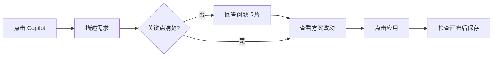

# 工作流 Copilot 发布说明

毕昇 3.1 在工作流编辑页新增 Copilot：用一句话描述需求，就能生成一条新工作流或修改现有工作流；改动在应用前逐项列出，应用后可一键撤销，生成的节点自动折叠并排列整齐。

# 一、功能介绍

## 1. 背景

搭建工作流需要先熟悉 12 类节点及各自的参数，新手很难一次搭对；修改已有工作流也只能逐个节点手动调整。另一方面，用户描述需求时常漏掉关键细节，例如金额的币种、「超过 500」是否包含 500，搭出来的工作流看起来完整，用真实数据一跑才发现不对。

## 2. 目标

1. 用户不熟悉节点参数，也能用自然语言得到一条能通过平台校验的工作流。
2. 修改已有工作流时，用户能在应用前看清改了什么，需求没提到的部分保持不变。
3. 需求中关键点没说清时，Copilot 先提问再生成；平台做不到的功能，Copilot 明确说明并给出替代做法。
4. 节点较多时，画布保持整齐可读。

## 3. 操作流程

**生成或修改工作流**

1. 打开工作流编辑页，点击顶栏右侧的「Copilot」，画布右侧打开 Copilot 面板。
2. 在输入框中描述需求，例如「做一个报销助手：员工输入报销金额和用途，超过 500 的需要审批」，点击发送。
3. 面板中先显示模型的思考过程，随后显示方案说明和「方案改动」清单：新增、删除、改动的节点和连线；改动的参数显示为「旧值 → 新值」。
4. 确认无误后点击「应用」，方案落到画布。新增的节点默认折叠，画布自动排列整齐。
5. 如需撤回，按 Ctrl+Z 一次即可恢复到应用前的画布。应用不会自动保存，确认后请点击顶栏「保存」。

**回答澄清问题**

需求中有影响结果的细节没说清时，Copilot 会先显示一张问题卡片，例如：

- 报销金额会不会是外币？（只有人民币 / 可能是外币，需要按固定汇率换算成人民币 / 其他）
- 「超过 500」是否包含金额正好为 500 元？（大于 500 时审批 / 大于等于 500 时审批 / 其他）
- 超过阈值后，「需要审批」具体执行哪种动作？

逐题点选（或选「其他」后填写），点击「按这些继续」，Copilot 据此生成方案。需求本身已经说清楚时，Copilot 直接给出方案，不会追问。

**阅读方案说明**

方案说明中会列出两类信息：

- **假设**：Copilot 自行决定的次要细节，例如「金额为人民币非负数，可包含小数」。
- **做不到 / 替代**：平台目前不具备的能力及替代做法，例如「平台没有审批节点，改用发送邮件工具通知审批人」。

**整理画布**

- 点击画布左下角工具栏的「自动布局」，节点按连线从左到右自动排列。
- 点击节点右上角的箭头可折叠或展开节点，画布随之自动重新排列。条件节点折叠后每个分支保留一行，输出节点（选择型交互）折叠后每个选项保留一行，连线不受影响。

# 二、软硬件依赖

| 依赖项 | 要求 | 说明 |
| --- | --- | --- |
| 毕昇版本 | 3.1（包含工作流 Copilot 的版本） | 必需 |
| 工作流默认模型 | 在「系统模型配置 → 工作流」中设置一个可用的对话模型 | 必需。未设置或模型已停用时，Copilot 面板会提示原因并禁用发送 |
| 模型能力 | 建议使用推理能力较强的模型；效果数据基于 MiniMax-M3 | 推荐。换用其他模型时生成质量可能不同 |
| 用户权限 | 对当前工作流有编辑权限 | 必需。无编辑权限的用户看不到 Copilot |
| 通知类工具 | 平台中已添加发送邮件、飞书、钉钉等工具 | 可选。没有时，Copilot 在需要通知或审批的场景下无法给出工具替代 |
| 硬件 | 无额外要求 | Copilot 调用已配置的模型服务，不占用本地显卡 |

# 三、功能效果参考

测试条件：2026 年 11 月 25 日，内部隔离测试环境；工作流默认模型与评判模型均为 MiniMax-M3；评测集 17 条用例，每条运行 3 次，共 51 次，覆盖需求清楚、需求有隐含缺口、平台做不到、修改已有工作流四类场景。

| 指标 | 改进前 | 改进后 |
| --- | --- | --- |
| 需求有关键缺口时先提问的比例 | 0% | 93% |
| 需求清楚时仍然追问的比例 | 0% | 0% |
| 平台做不到时明确说明并给出替代的比例 | 56% | 100% |
| 生成的工作流通过平台结构校验的比例 | 100% | 100% |
| 满足用例硬性要求的比例 | 82% | 96% |
| 样例输入得到正确结果的比例 | 79% | 92% |

生成耗时：使用 MiniMax-M3 等推理模型时，模型通常先思考 1–3 分钟再输出方案，单轮最长 10 分钟。

# 四、注意事项

1. **应用不等于保存**：应用后需点击「保存」，工作流才会被保存。保存后 Copilot 的对话仍保留；刷新页面、离开编辑页或打开另一条工作流时对话清空，平台不保存对话内容。
2. **资源需要确认**：方案中的模型、知识库、工具只在当前用户有权使用的范围内匹配；无法唯一确定的项在方案改动中标为「需要你选」，应用后请在对应节点上手动选择。
3. **平台能力不变**：Copilot 不会新增平台没有的节点类型，也不会替用户保存、上线或运行工作流。平台关闭代码节点时，Copilot 不会生成代码节点。
4. **画布或对话过长**：画布超过 500 个节点，或对话过长时，Copilot 会提示精简后重试或开始新对话。
5. **已知限制**：展开节点后立即拖动其他节点，自动重排会被取消，展开的节点可能与相邻节点重叠，此时点击「自动布局」即可恢复整齐。
6. **管理员新建工作流**：全局超级管理员在管理视角切换到其他租户时不能新建工作流，系统会提示「请先把管理视角切回你所属的租户，再新建工作流」。
