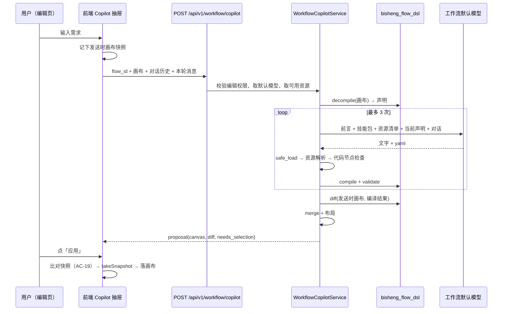

# Design: 工作流编辑页 copilot

> **本文档定位 — 现状快照（Why this How）**
>
> - `spec.md` 回答 **做什么**（目标、AC、边界）
> - `design.md`（本文）回答 **为什么这么实现**：关键决策、运行时不直观的事实、对外契约
> - `tasks.md` 是 **流水账**：拆了哪些任务、做了什么改动
>
> 调整原则（详见 `docs/SDD-Guide.md` §3-§4）：实现变化 → 覆盖更新本文档，只留今天的状态；每个决策保留「为什么 + 被否方案」和坑。推翻已 ★ 确认的决策 → 停下与用户重新确认。

**状态**：草稿，待用户确认（2026-11-23）。**对应 spec**：[spec.md](./spec.md)（2026-11-23 用户已确认）。

---

## 1. 目标与非目标

**目标**：在工作流编辑页提供一个 copilot。用户用自然语言提需求，系统产出一份**经过与 CLI 同一套规则校验**的工作流方案，以差异预览呈现，用户点「应用」后落到画布，可撤销。

**非目标**（spec 范围边界的技术侧投影）：不保存 / 上线 / 运行；不持久化对话；不改工作流运行时与校验规则；不为 copilot 另写一份编译规则或节点知识。

---

## 2. 关键约束

| 约束 | 来源 | 对本设计的影响 |
|---|---|---|
| 平台与 CLI 编译规则只能有一份 | 用户决策（F007 立项）、spec AC-23 | 编译器必须被后端与 CLI 共同使用（决策 1） |
| 后端镜像的构建上下文只有 `src/backend/` | `src/backend/Dockerfile`（`COPY ./ ./`） | 后端拿不到 `src/bisheng-cli/` 下的源码 |
| CLI 对后端包零耦合、依赖预算两项（httpx、PyYAML） | `src/bisheng-cli/pyproject.toml` | CLI 不能 import `bisheng.*`；共享代码只能用标准库 + PyYAML |
| 架构铁律 C1–C8 | `docs/constitution.md` | 本特性涉及：C1（copilot 逻辑放 `workflow/domain/services/copilot/`）、C3（不手传 tenant_id）、C4（复用 `judge_flow_write_permission`）、C5（错误码，见 §4.2）、C7（请求函数放 `controllers/API/`）、C8（只读随包文件）。**不新增表 ⇒ C2 不涉及**；C6 照常 |
| 后端未直接声明 PyYAML（只是传递依赖） | `src/backend/pyproject.toml`、`uv.lock` | copilot 要 `safe_load` 模型输出、中立包要 dump，后端须把 PyYAML 提为直接依赖；锁里已有，版本不变 |
| 「工作流默认模型」只有 `model_id` 一个字段 | `llm/domain/schemas.py` `EvaluationLLMConfig` | 「模型不可用」要另查模型记录（spec AC-03） |
| 代码节点闸门只在运行期 | `core/config/settings.py` `WorkflowConf.code_node_enabled`；编译器 / 校验器不查 | copilot 自己挡（决策 6） |

---

## 3. 方案对比与选定

### 决策 1：编译器怎么让平台与 CLI 共用（★ 需用户确认）

**备选**：

| 方案 | 做法 | 问题 |
|---|---|---|
| A | 后端把 `dev_toolkit/artifacts/` 里随附的 CLI 安装包当依赖装上 | 安装包每次重打内容都变、版本号不变 ⇒ 后端 `uv.lock` 每次都要重锁；本地改了编译器，后端要等重打 + 重锁才看得到新代码，开发时后端测的是旧代码；CLI 的 `bisheng` 命令也被装进后端环境 |
| **C（选定）** | 把编译相关代码挪成一个**中立包** `src/backend/bisheng_flow_dsl/`（与 `bisheng_langchain/` 并列，后端直接 import）；CLI 打安装包时把它一并打进去，CLI 代码改为 import 它 | CLI 构建要跨目录取文件；可复现打包配方与 CI 触发路径要跟着改 |
| D | 后端提供编译接口，CLI 改为调接口 | 推翻 F005「离线编译」决策，CLI 离线不可用 |
| E | 复制一份到后端，CI 逐字节比对 | 仍是两份，违背用户「不能再复制第二份」 |

**选定 C**。**原因**：
- **源码只有一份**：后端与 CLI 的测试都直接跑这份源码（AC-23 的字面要求）。
- **后端改动小**：照 `bisheng_langchain` 的既有先例导入（`bisheng/linsight/worker.py:28`），后端运行时的 `PYTHONPATH=./` 已能导入顶层包。后端唯一的依赖改动是把 PyYAML 从传递依赖提为直接依赖（见 §2）。
- **CLI 零耦合不变**：CLI 依赖的是一个只用标准库与 PyYAML 的中立包，而不是 `bisheng`。

**CLI 开发期要注意（已核实）**：hatchling 的 `force-include` 在 editable 安装时是把文件**复制**进去（`hatchling/builders/wheel.py` `recurse_forced_files`），不是链接。所以改了中立包之后：
- **CLI 测试**：在 pytest 配置里把 `../backend` 加到导入路径最前面（`pythonpath = [".", "../backend"]`），测试永远跑最新源码。
- **本机 `uv run bisheng`**：要 `uv sync --reinstall-package bisheng-cli` 才生效。这一点写进 CLI 的 README。
- **副作用**：上面的导入路径也会让 CLI 测试能 import `bisheng`。由两道检查兜住：
  1. 边界测试：扫描 `bisheng_cli/` 与 `bisheng_flow_dsl/` 的 import，不得出现 `bisheng.`、`bisheng_langchain`；
  2. 既有的「空环境装安装包」冒烟测试。

  被否的替代做法是 hatchling 的 `dev-mode-dirs`：它同样暴露整个 `src/backend`，而且加的路径排在 site-packages 之后，会被安装进去的副本遮住。

**中立包的边界**：
- 进包：`compiler`（声明 → 画布）、`validate`（结构校验）、`diff`（结构化差异）、新增 `decompile`（画布 → 声明，决策 2）、`dump`（声明 → YAML 文本）、`errors`（包自己的 `DslError`）。
- 不进包：读文件与 `!include` 展开（`spec.py`）、覆盖层（`overlay.py`）、HTTP 客户端、项目绑定——都是 CLI 专属。
- 包内**不得** import `bisheng` 或 `bisheng_cli`；CLI 侧把 `DslError` 包成 `CliError`，退出码与输出契约不变。由一条测试守住这条边界：扫描包内 import 语句。

**何时推翻**：第一个探路任务先验证三件事：
1. 用 Linux 容器的可复现配方打出的安装包里含 `bisheng_flow_dsl`；
2. 空环境装上这个安装包后，`bisheng flow compile` 能用；
3. CLI 测试跑的是源码，不是装进去的副本：故意改坏中立包，CLI 测试必须变红。

任何一条做不到且没有干净解法，就退回方案 A，并把「每次改 CLI 都要重锁后端」写进 CI 检查。

**连带修订**（用户确认本决策后同步）：
- release-contract 表 1 F005 行：「CLI 侧的声明编译」改为「声明编译 / 校验 / 对比的实现在中立包 `bisheng_flow_dsl`，平台与 CLI 共用」。
- 可复现打包配方（`git archive` 的路径）、`scripts/pack_cli_wheel.sh`、`cli-quality.yml` 的触发路径：都要加上 `src/backend/bisheng_flow_dsl/`。

### 决策 2：模型产出什么

**备选**：①直接产出画布 JSON；②产出对画布的增量补丁；③**产出完整的工作流声明（YAML）**。

**选定 ③**。**原因**：
- 技能包教的就是这种写法（AC-22），模型看到的写法和产出的写法一致。
- 完整声明可以直接用编译器校验（AC-10、AC-23）。画布 JSON 的结构太大，模型很难写对；补丁则无法独立校验。
- 「改了什么」由决策 3 的差异算法算出来，不依赖模型自报。

**代价**：大画布时模型每轮都要重写整份声明，输出较长。用长度上限兜底（决策 7），超出时明确告知用户（spec §3）。

为此每轮先把**发送时的画布**反编译成声明（`decompile`）交给模型。反编译时保留画布原有的节点 id，未改动的节点在差异算法里就能对上。

### 决策 3：「应用」是在原画布上合并差异，不是整体替换

**备选**：①把编译结果整个换上画布；②**原画布 + 差异**。

**选定 ②**。**原因**：声明格式表达不了便签、画布视角、未识别字段（已实测：`compiler.py` 的节点键集合封闭，便签走 `unknown_type`）。整体替换必然丢掉这些内容，违反 AC-08。

**合并规则**（后端 `copilot/merge.py`）：

以 `diff(local=编译结果, online=发送时画布)` 为准。参数顺序沿用 F005 `diff(local, online)` 的语义（`diff.py:58`），所以：
- `nodes_only_local` = 方案**新增**的节点；
- `nodes_only_online` = 方案**删除**的节点；
- 参数条目 `{key, online: 旧值, local: 新值}`。

**全文只用这一种口径**，前端也照此显示。

- **只在方案里有的节点**：取编译结果，位置按决策 8 安排。
- **只在原画布里有的节点**：删除。**便签除外**，便签永远保留（`diff` 本来就把便签单独拆出，不计入节点差异）。
- **两边都有且有改动的节点**：以原节点对象为底，只覆盖差异里列出的参数值和名称 / 描述 / 分支设置；位置和未识别字段不动。
  - 条件分支存在 `condition` 参数里，不在节点字段里（`compiler.py:144-148`），按参数覆盖。
  - 同一个参数 key 在节点里出现多次时，`diff` 的 `_one()` 会返回列表（`diff.py:202-204`）。这种情况不能直接赋值，要按出现顺序逐个对应覆盖；数量对不上就整节点取编译结果，并在差异里把这个节点标为「整体替换」。
- **连线**：按差异增删，其余保留原对象。

合并出的画布与差异列表一起返回前端。前端只负责展示和落画布。这样 AC-17「预览列出的」与 AC-18「应用落下的」是同一份数据，不会不一致。

### 决策 4：资源由模型写名称，后端解析成 id

**做法**：
- **模型侧**：copilot 前言告诉模型「资源一律写名称」，并附上当前用户可用的模型、知识库、工具名称清单。
- **后端识别资源参数**：按节点模板里的参数类型识别（`bisheng_model`、`agent_model`、`knowledge_select_multi`、`add_tool`；工具节点用 `tool:`），**不写死参数名**，模板新增资源参数自动生效。
- **可用范围**：尽量与画布下拉框同源，让「可用」的口径与网页一致（AC-15）。三类资源的取法不同（已核实签名）：
  - **知识库**：`KnowledgeService.get_knowledge(request, login_user, knowledge_type, …, action="use")`（classmethod）。它返回游标分页（每页 10 条），所以要对两类知识库（文档库 0、问答库 1）分别翻完所有页。
  - **工具**：`ToolServices(login_user=…).get_tool_list(is_preset=None, action="use")`。这是实例方法，`use` 分支按 `batch_check_business_actions(actions=("use",))` 过滤，返回的每个子工具都带 `node_template`，可以直接交给编译器。
  - **模型**：`LLMService.get_all_llm` 返回模型服务列表，**没有** `use` 语义，也不过滤下线的模型。copilot 自己筛选：类型为 LLM，且 `online=True`（`llm_server.py:73`）。这和画布模型下拉框的口径一致（下拉框用的也是这个列表），模型不按用户分权限。
- **唯一匹配**：填入 id。
- **无匹配或多个候选**：
  - 模型填 `0`，知识库填空列表。这两个占位值都能通过编译，平台既有的保存 / 运行校验会在用户没选时拦住。
  - 同时在返回里的 `needs_selection` 列出该处，附带候选名单。
- **用户直接写了 id**：只要它不在可用清单里，就按无匹配处理（AC-16）。

**工具节点的特殊情况**（★ 请确认）：独立的工具节点整个就是那个工具，画布上没有「工具留空」这种状态。所以工具名对不上时，方案**不包含这个节点**，并在预览的「需要你选」里列出「工具 X：候选 A、B / 未找到」。用户从节点面板拖入即可。Agent 节点的工具列表可以为空，按 AC-15 原文执行。这是对 AC-15「留空」在工具节点上的具体落法。

**被否**：让模型直接写 id。模型会编造 id，而且 id 对用户不可读，差异预览也看不懂。

### 决策 5：技能包整份喂给模型，加一段 copilot 前言

**备选**：①按章节摘取技能包里与写法有关的部分；②**整份 + 前言覆盖**。

**选定 ②**。**原因**：技能包第 1–2 章是给命令行助手的流程（compile / push / 停下问人），对 copilot 不适用。但按标题切片很脆弱，技能包改个标题就会切错。前言用明确的优先级覆盖这两章：只输出一个 yaml 代码块、资源写名称、不做 push、不问资源 id。

技能包约 28 KB，在模型上下文里可以承受。

前言放在后端 `copilot/prompt.py`。技能包从后端包内的 `dev_toolkit/skills/workflow-as-code/SKILL.md` 读取，这是只读的随包文件，不违反 C8。

### 决策 6：校验 → 回喂 → 重试，最多 3 次

每轮最多调用模型 3 次。每次产出后依次过以下检查：
1. 用 `yaml.safe_load` 解析（**不认 `!include`**）。
2. 解析资源。
3. 编译 + 校验。
4. **代码节点检查**：平台关闭代码节点时，方案里出现代码节点就判为一条校验问题。编译器不管这个开关，只能在 copilot 这一层挡（AC-12）。

有问题就把问题列表（用 `describe()` 的人话文本）回喂给模型重试。3 次都不过，就返回问题列表，不提供「应用」（AC-10）。

**为什么 `!include` 必须拒**：命令行里 `!include` 读的是开发者本机的文件。在服务端，它会变成「模型或画布里的提示词让后端读服务器上的任意文件」。`safe_load` 遇到未知标签直接报错，这正是想要的行为。

### 决策 7：传输用 POST + 按行 JSON 流，停止 = 断开连接

**备选**：
- ①照助手 `/assistant/auto` 的写法：先 POST 存任务，再用 GET 的 EventSource 拉流。浏览器的 EventSource 只能发 GET，带不了画布这样的大请求体。
- ②**直接 POST 返回按行 JSON 流**。前端已有 `controllers/requestStream.ts`，只需扩展它支持请求体。

**选定 ②**。用户点停止时，前端中断 fetch，后端随即取消本轮（AC-11）。

**已核实的取消机制**：后端锁定的 starlette 是 0.49.3（`uv.lock`）。在 ASGI `spec_version < 2.4` 时，`StreamingResponse` 用一个 task group 同时跑「输出流」和「监听断开」，收到 `http.disconnect` 就取消输出流。uvicorn 的 HTTP 实现上报的版本是 2.3。

成立有两个前提，实现时必须守住：
1. **模型调用必须在生成器里直接 `await`**：不能丢进线程或后台任务，也不能 `shield`，否则取消传不到模型调用。
2. **升级 uvicorn / starlette 时要复查**：若上报的版本变成 ≥ 2.4，就不再监听断开了。由一条端点测试守住：模拟断开后，假模型的调用必须收到取消。

**事件**（每行一个 JSON）：

| type | 内容 |
|---|---|
| `delta` | 模型回复里 yaml 代码块之外的文字增量 |
| `status` | 阶段：`generating` / `validating` / `retrying`，带第几次尝试 |
| `proposal` | `canvas`（合并后的完整画布）、`diff`、`needs_selection`、`base_digest`（发送时画布的摘要） |
| `issues` | 3 次都没通过时的问题列表 |
| `error` | 错误码 + 可读原因（AC-27） |
| `done` | 本轮结束 |

**长度上限**：发送时画布反编译出的声明超过 60 000 字符，或对话历史超过 20 轮，直接返回错误码，不截断（spec §3：不能只基于部分画布产出方案）。

### 决策 8：新节点的位置

编译器给没写位置的节点按「序号 × 320」横排，一定会和现有节点重叠（AC-09）。

合并时对新增节点重新安排位置：
- 先在新画布上从开始节点按连线做广度遍历，算出每个新节点的层级。
- 新节点放在**原画布包围盒右侧**，同一层级的节点纵向排开。
- 原有节点的位置一律不动。

### 决策 9：发送后画布又被改动的检测放在前端

发送时，前端记下画布的规范化快照。规范化时只取：
- 节点：`id`、`data`、`position`；
- 连线：`source`、`sourceHandle`、`target`、`targetHandle`。

React Flow 运行时会往节点上加 `selected`、`dragging`、`measured` 这些状态字段，规范化时去掉，不然点一下节点就会被当成「改动」。

点「应用」时，用同样规则规范化当前画布再比对。不一致就弹确认框（AC-19）。

只在前端比对，因为发送后的改动只存在于浏览器里，后端看不到。

### 决策 10：抽屉的位置与和测试运行面板的互斥

- copilot 抽屉做成画布区右侧的固定面板，与 `FlowChat/ChatTest.tsx` 同一位置（`fixed right-0`）。
- **互斥**：`ChatTest` 目前只通过 ref 暴露 `run` / `close`，开关是组件内部状态。改动是给它加一个 `onOpenChange` 回调：它打开时通知编辑页收起 copilot；copilot 打开时调用 `testRef.current.close()`。
- **对话不丢**：对话状态提升到 `Panne` 一级，收起抽屉不清空（AC-21）。离开页面时组件卸载，状态自然清空。

### 决策 11：应用必须先拍快照

`Panne.tsx` 里现有的 `onImportFlow` 只 `setNodes` / `setEdges`，不调 `takeSnapshot`，所以现在的「导入工作流」不能撤销。

copilot 的应用走一个新回调：先 `takeSnapshot()`，再落合并后的画布，不改视角。这样一次 Ctrl+Z 就能回到应用前（AC-18）。

现有导入的撤销缺陷不在本特性范围，记入 §8。

### 决策 12：CLI 新增 `bisheng flow export`

用法：
```
bisheng flow export [--flow <id>] [-o flow.yaml]
```

- **流程**：读线上当前版本 → 用中立包的 `decompile` 转成声明 → 写出 YAML。
- **被略过的内容**：便签、视角、未识别字段在 stderr 逐项列出；`--json` 模式下放在 `details.omitted` 里（AC-24）。
- **提示词**：内联写在 YAML 里，不拆成 `!include` 文件。拆分以后再说。

**为什么做**：copilot 本来就需要反编译。CLI 只要加一个子命令就能复用它，也正好用来验证反编译这一来一回是不是无损的。

---

## 4. 系统现状（实现后的预期形态）

### 4.1 数据流



### 4.2 关键数据结构 / 字段约定

**请求** `POST /api/v1/workflow/copilot`（登录态，返回 `application/x-ndjson`）：

```json
{
  "flow_id": "…",
  "canvas": {"nodes": [...], "edges": [...]},
  "history": [{"role": "user|assistant", "content": "…"}],
  "message": "加一个摘要节点"
}
```

- `history` 中 assistant 的内容只含文字回复，不含 yaml。每轮的基础是画布，不是上一轮的方案（AC-07）。
- `proposal.diff` 沿用 F005 `diff()` 的结构，调用方式是 `diff(local=方案, online=发送时画布)`（决策 3）：`nodes_only_local` = 新增，`nodes_only_online` = 删除，`nodes_changed`，`edges_*`。前端用 `node.<type>.<key>` 的本地化文案显示参数名。
- **错误码**（105 段内新开 10560–10569 子段，`common/errcode/flow.py`）：
  - 10560 工作流默认模型未配置（AC-03）
  - 10561 工作流默认模型已删除或停用（AC-03）
  - 10562 画布或对话超出长度上限（决策 7）
  - 10563 模型调用失败或超时（AC-27）
  - 10566–10569 预留

  实现时在同一次提交里更新 release-contract「已分配模块编码」一节（该节现写「本版本增量未分配错误码」）。105 是既有模块号，不需要改 constitution C5 的模块表。

  无编辑权限沿用既有的权限错误（AC-04）。方案没通过校验不是错误码，走 `issues` 事件（AC-10）。

  端点在开始流式响应之前就能判定的错误（权限、默认模型、超长），直接返回普通 JSON 错误；流开始之后的错误放进 `error` 事件。
- `needs_selection` 每项包含：`node_id`、`param_key`（工具节点为 `tool`）、`kind`（model / knowledge / tool）、`wanted`（模型写的名称）、`candidates`（候选名称，最多 10 个）。

### 4.3 关键模块职责

| 位置 | 职责 | 不做什么 |
|---|---|---|
| `src/backend/bisheng_flow_dsl/` | 中立包：compile / validate / diff / decompile / dump / errors | 不读文件、不发 HTTP、不 import `bisheng` / `bisheng_cli` |
| `src/bisheng-cli/bisheng_cli/flow/` | CLI 外壳：读文件、`!include`、覆盖层、HTTP、把 `DslError` 包成 `CliError`；新增 `export` | 不再自带编译 / 校验 / 对比逻辑 |
| `copilot/service.py` | 编排一轮：取模型、取资源、调模型、重试、产出事件 | 不做权限判定（端点做），不改画布 |
| `copilot/prompt.py` | 前言、技能包、资源清单、当前声明、对话的拼装与长度检查 | 不调模型 |
| `copilot/resources.py` | 可用资源清单与名称 → id 解析、`needs_selection` | 不判定「有没有权限」，可用范围完全取自既有服务 |
| `copilot/merge.py` | 原画布 ⊕ 差异、新节点布局 | 不调模型，不读数据库 |
| `bisheng/api/v1/workflow.py` | `POST /workflow/copilot` 端点：编辑权限、流前错误、流式响应 | 不含 copilot 业务逻辑 |
| `bisheng/common/errcode/flow.py` | 10560–10563（10566–10569 预留） | — |
| 前端 `pages/BuildPage/flow/Copilot/` | 抽屉、对话列表、差异预览、「应用」、AC-19 比对 | 不自己算差异，不发 HTTP（经 `controllers/API`） |
| 前端 `controllers/requestStream.ts` / `controllers/API/workflow.ts` | 流式请求（扩展为支持请求体）与 copilot 请求函数 | — |

---

## 5. 已知坑 / 反直觉事实

1. **便签不在声明里**。不知道这一点、整体替换画布的话，用户的便签每用一次 copilot 就全没了。→ 决策 3。
2. **`!include` 在服务端是任意读文件**。用 `yaml.load` 或复用 CLI 的 `spec.py` 读模型输出，等于让提示词决定后端读哪个文件。→ 只用 `safe_load`。
3. **编译器不管代码节点开关**。只靠编译校验的话，平台关了代码节点，copilot 照样能产出，要到运行时才报错。→ 决策 6。
4. **「工作流默认模型」配置只有 id**，被删或停用的模型照样能读出来。→ 端点先查模型记录，不可用返回 10561。
5. **`onImportFlow` 不进撤销栈**。照抄它做应用，Ctrl+Z 撤不回。→ 决策 11。
6. **React Flow 往节点上加运行时状态字段**（`selected` / `dragging` / `measured`）。直接拿节点对象比对的话，点一下节点就会触发 AC-19 的确认框。→ 决策 9。
7. **网页保存的 `model_id` 是数字，模型可能写成字符串**。`diff` 用规范化 JSON 比较，`7` 和 `"7"` 算不同。资源解析出的 id 一律按数字写回，否则未改动的节点会被报成「改了模型」。
8. **反编译遇到老画布**。网页早期版本存的节点 `v` 较旧，可能缺少当前模板的参数。反编译时缺的参数不写，编译时按模板默认值补上。`diff` 会把这类节点报成「改了参数」。反编译测试要用真实老画布做样本，确认差异只出现在这类被补上的参数上。
9. **画布内容本身可能带注入**。别人写的提示词会被原样喂给模型，可能诱导模型乱改。兜底有三层：方案必须经用户看差异、点应用才生效；资源 id 由后端按权限重新解析；copilot 不执行任何工具。

---

## 6. 对外契约与依赖

### 6.1 我提供给别人的（Outgoing）

| 契约 | 消费方 | 改了会破坏谁 |
|---|---|---|
| `POST /api/v1/workflow/copilot`（NDJSON 事件流） | 平台前端 | 前端抽屉 |
| 中立包 `bisheng_flow_dsl` 的 compile / validate / diff / decompile | 平台后端、`bisheng` CLI | 两边同时受影响。这正是要的效果，但改动要同时跑两边测试 |
| `bisheng flow export` | 开发者、AI 编程助手 | 技能包「工作流声明」要补一段用法（随本特性更新） |
| 错误码 10560–10569 | 前端提示文案 | locales 三语 |

### 6.2 我依赖别人的（Incoming）

| 依赖 | 提供方 | 用法 |
|---|---|---|
| 节点模板 `NODE_TEMPLATES` | F005 | 编译、反编译、按参数类型识别资源 |
| 技能包 SKILL.md | F006 | copilot 的写法知识 |
| `LLMService.aget_workflow_llm_with_meta`、`get_bisheng_llm` | llm 模块 | 默认模型与调用；按 `app_type=WORKFLOW`、`app_id=flow_id` 计入既有用量统计 |
| `FlowService.judge_flow_write_permission` | 既有 | 编辑权限（AC-04） |
| `KnowledgeService.get_knowledge(request, login_user, knowledge_type, …, action="use")`（游标分页，需翻完）、`ToolServices(login_user).get_tool_list(None, "use")`、`LLMService.get_all_llm`（自行筛 LLM 类型且 `online=True`） | knowledge / tool / llm 模块 | 可用资源清单（决策 4） |
| `WorkflowConf.code_node_enabled` | 既有配置 | AC-12 |
| `useUndoRedo().takeSnapshot`、`ChatTest` | 前端既有 | AC-18、AC-02 |

---

## 7. 测试与可观测

**测试策略**：
- **中立包**：
  - CLI 现有的编译、校验、对比测试全部改为面向中立包，并且必须照常通过（这是「挪包不改行为」的证明）。
  - 新增反编译往返测试，样本包括 F006 的两个样例和从隔离环境导出的真实画布：反编译再编译，`diff` 无差异；有差异的只能是坑 8 那类被补上的参数。
  - 新增包边界测试：`bisheng_flow_dsl/` 内不得出现 `import bisheng` / `bisheng_cli` / `bisheng_langchain`；`bisheng_cli/` 内不得出现 `bisheng.` 或 `bisheng_langchain`（决策 1 的副作用兜底）。
  - 探路任务的三项验证（决策 1「何时推翻」），其中「改坏中立包 CLI 测试必须变红」做成变异检查。
- **后端 copilot**：用脚本化的假模型按顺序给出预设输出，覆盖：
  - 一次通过；
  - 校验失败后重试成功；
  - 3 次都失败；
  - 输出带 `!include` 被拒；
  - 代码节点被挡；
  - 资源唯一 / 多候选 / 无权限 / 用户手写 id；
  - 合并后便签和未识别字段保留；
  - 新节点不重叠；
  - 无编辑权限被拒；
  - 默认模型未配置 / 不可用；
  - 超长；
  - 模型调用抛错。

  端点层验证事件流的顺序与结构，以及日志里不出现画布全文（AC-25）。
- **前端**（vitest）：
  - 应用后一次撤销回到原画布；
  - 发送后改画布会触发确认框，只点选节点不触发；
  - 与测试运行面板互斥；
  - 收起抽屉对话不丢。
- **端到端**（本机隔离环境 `_probe/e2e/`，不碰现有毕昇与 invest）：
  1. **起环境**：`docker compose -f _probe/e2e/docker-compose.yml up -d`（基础设施）。然后启动后端和 worker：`BISHENG_BACKEND_DIR=<本特性工作目录>/src/backend bash _probe/e2e/serve.sh api`，worker 同理把 `api` 换成 `worker`。前端用本特性工作目录的 `pnpm dev`，后端地址指向 `127.0.0.1:17860`。
  2. **配模型**：用管理员账号在「系统模型配置 → 工作流」设置默认模型。**用哪个模型服务要先经用户授权**（G5：不连未授权的外部生产资源），凭据只走环境变量或页面录入，不写进任何文件。〔待研发确认：具体用哪个模型服务〕
  3. **验证**：
     - **新建**：空画布输入「做一个多轮对话助手，用户说结束就停」→ 看差异（全是新增）→ 应用 → 画布出现节点 → Ctrl+Z 回到空画布。
     - **修改**：已有画布加一条便签后输入「在回复前加一个摘要节点」→ 差异只列新增节点和改动的连线 → 应用 → 便签仍在。
     - **改动后应用**：发送后、应用前拖动一个节点 → 点应用 → 出现覆盖确认框。
     - **无权限**：用无编辑权限的账号直接调用 `POST /api/v1/workflow/copilot` → 返回权限错误。
  4. **CLI 往返**：`bisheng flow export` 导出同一工作流，再 `bisheng flow diff` 对比 → 无差异，且导出时列出了被略过的便签。

**可观测**：每轮记一条日志，内容只含：flow_id、尝试次数、结果（通过 / 校验失败 / 出错）、耗时、声明长度。不记画布与对话原文（AC-25）。

---

## 8. 后续改进 / 不打算做的事

- **现有「导入工作流」不能撤销**（坑 5）：本特性不修，单独提。
- **对话持久化与多人共享**：spec 已排除。
- **`flow export` 把提示词拆成 `!include` 文件**：以后再说。
- **校验规则补强**（F006 遗留）：rag / knowledge_retriever 的输出条数、rag 必须引用 `retrieved_result`。补上之后 copilot 自动受益。
- **大画布只把相关子图交给模型**：等真遇到长度问题再做。

---

## 修订历史

| 日期 | 变更 |
|---|---|
| 2026-11-23 | 初稿（待用户确认） |
| 2026-11-23 | 按 codex design 审查修订：差异参数顺序统一为 diff(local=方案, online=发送时画布)；补 editable 复制语义与 CLI 测试导入路径；PyYAML 提为后端直接依赖；资源服务签名与模型筛选口径；停止机制的两个前提；职责表「不做什么」；端到端步骤；错误码登记 |
