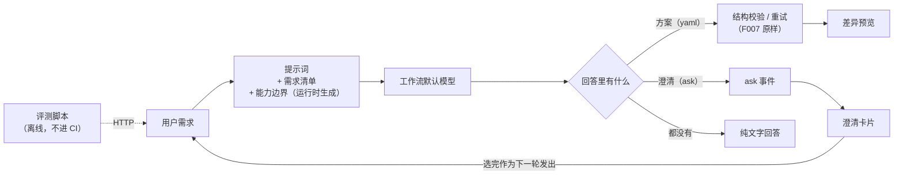

# 工作流 copilot 生成质量 — 设计

> How 的唯一真相。需求口径见 [spec.md](./spec.md)（AC 编号以 spec 为准）。
> **状态**：2026-11-25 用户已确认（codex 设计审查两轮 31 → 38/50 后修订；评判模型用 MiniMax-M3）。

## 1. 总体



方案 A：每一轮仍是**一次**模型调用；需要澄清时会多出「作答」这一轮。变化集中在提示词、回答解析和抽屉卡片。评测脚本走平台真实 HTTP 接口，测的是用户实际得到的效果。

## 2. 决策

| # | 决策 | 理由 |
|---|---|---|
| 1 | 澄清用新的 ```` ```ask ```` 回答块（YAML 列表），由 F007 的同一套围栏切分识别；正文不下发为文字 | 与方案块同一种写法；复用已加固的切分（行首围栏、分块无关、未闭合块） |
| 2 | 方案优先：同一回答里有可用方案时以方案为准，问题转成文字附在回复后；**澄清不能吞掉方案**（§4 的两条兜底） | spec 边界；不让新格式让 F007 已能出的方案丢失 |
| 3 | 能力边界在运行时由节点模板类型、代码节点开关、当前用户可用工具生成；提示里的「审批、定时触发…」只是举例说明「节点类型之外」，判断以节点类型为准 | AC-07 |
| 4 | 卡片提交与普通发送区分：提交只把**本卡片**标为已作答；普通发送把其余未作答卡片标为「未作答」 | AC-04（审查 #1） |
| 5 | 送给模型的历史由「历史文本」单独拼出：助手轮 = 回复文字 + 问题的文字形式；界面显示的 `turn.text` 不变。只有问题、没有文字的一轮也进历史 | 下一轮要知道问过什么（审查 #8） |
| 6 | 每次对话最多 2 轮澄清，之后按假设直接出方案；问题的文字形式紧凑 | 历史上限是硬性报错（10562），澄清轮会消耗它（审查 #9） |
| 7 | 评测脚本在仓库里、只认环境变量；本机隔离环境的登录与取密钥在仓库外的包装脚本里做，只在进程内存 | 可移植；不落盘密钥 |
| 8 | 评测用专用账号 `e2e-eval`；临时工作流名带本次运行 id，只删本次创建的 | 不动他人账号与数据；并发运行互不干扰（审查 #17） |
| 9 | 指标定义以「本轮没有方案」为前提判断「问了」；内容（问到哪些点）与格式（是否用卡片）分开统计；每条默认跑 3 次并给出置信区间 | 让基线与方案 A 可比，且不把「问了又给方案」算成功（审查 #11–#13） |

## 3. 提示词（`copilot/prompt.py`）

在 PREFACE 的「回答格式」之前插入两节，并改写「回答格式」：

**需求检查（先问再做）**——出方案前逐项检查：单位 / 币种 / 格式；数值边界是否包含；空或异常输入；循环何时结束；会产生副作用的动作（通知、审批、写入数据）具体怎么做；输入从哪来、结果给谁。
- **关键点**（不说清会让结果错、或会触发副作用）且用户此前没回答过 → 只输出 ```` ```ask ```` 块，不输出方案；
- **次要点**（任何合理默认都可）→ 自行决定，写进方案说明的「假设」；
- 本次对话已经澄清过 2 轮时不再提问，未明确的按合理假设处理并写进「假设」。

**平台能力边界**（运行时生成，`capabilities_section(catalogue, code_node_enabled)`）：
- 「平台的节点类型只有：…」（来自 `NODE_TEMPLATES` 的类型与中文名；代码节点关闭时不列入并注明已关闭）；
- 「当前可用、可用来通知或发消息的工具：…」（从当前用户可用工具中按名称挑出邮件、飞书、钉钉、企业微信类；没有就写「无」）；
- 规则：需求要用节点类型之外的能力（例如审批、定时触发、数据库读写、HTTP 请求，仅为举例）时，在「做不到 / 替代」里写明做不到的部分，并给出最接近的替代（优先上面的工具；接外部系统需先在平台「工具」里注册自定义工具）；不许不加说明地降级。

**回答格式**（改写后）：
- 需要澄清：一两句说明 + 一个 ```` ```ask ```` 块：
  ```
  - id: currency
    question: 金额会不会是外币？
    options: [只有人民币, 要按固定汇率换算成人民币]
  ```
  最多 3 题，每题 2–4 个选项，不写「其他」（界面自带）；澄清时不要输出 yaml。
- 给出方案：说明里依次写「做什么」、「**假设：**」（列表，没有就不写）、「**做不到 / 替代：**」（列表，没有就不写），然后一个 yaml 块（F007 规则不变）。

## 4. 回答解析与事件（`copilot/service.py`）

`_FenceFilter`：信息串为 `ask` 的块按隐藏块处理——正文不下发为 `delta`、不进回复，记入 `blocks`；新增 `ask_block()`。一次尝试结束后按顺序判断：

1. **先认出伪装成 yaml 的问题列表**：yaml 块的内容解析为列表、且每项有 `question` 与 `options` → 把它当作 ask 块，不当作方案。（审查 #6；必须在第 3 条之前判断）
2. **再从 ask 块里找方案**：ask 正文里只要能切出 yaml 块（不论 ask 本身是否合法），切出的 yaml 就作为方案候选。（审查 #5）
3. **有方案（第 2 条的候选或普通 yaml 块）** → F007 原流程（校验 / 重试 / 方案）；若同时有可用的问题，把问题的文字形式追加到回复。
4. **没有方案、有合法问题** → 发 `message`（回复文字）与 `ask` 事件 `{"type":"ask","questions":[{"id","question","options"}]}`，本轮结束，`outcome=ask`，不重试。
5. **没有方案、问题不合法** → 块原文以文字附在回复后，按纯文字回答结束。

规范化（`safe_load`，禁别名、限嵌套）：题目超过 3 道取前 3 道；选项去重后超过 4 个取前 4 个；选项少于 2 个的题目丢弃；`id` 缺失或重复时按序号重编；题目与选项各截到 200 字；有裁剪时在回复末尾注明「问题较多，只列出前 3 个」。全部题目被丢弃时按不合法处理。日志一行增加 `outcome=ask`，不记录问题内容。

**停止**：澄清轮在 `ask` 事件之前被停止时，与 F007 的停止相同——不出卡片、不进历史。（审查 #10）

**历史上限**：澄清轮会消耗 F007 的历史上限（超限是硬性的 10562）。约束只在提示词层（每次对话最多 2 轮澄清），服务端不另设计数；超限时沿用 F007 的提示（精简后重试或开始新的对话）。这是已知取舍：正常使用每次对话最多多出 2 轮，远低于 20 轮上限。（审查 #9）

## 5. 抽屉（`Copilot/`）

- 新组件 `AskCard.tsx`：每题一组单选按钮 + 「其他」（选中后出现输入框，必须非空）；全部作答后「按这些继续」可点。提交：本卡片标为已作答，答案拼成一条用户消息发出（「金额会不会是外币？：要按固定汇率换算成人民币；『审批』怎么发起？：发邮件给主管」）。
- `Turn` 增加 `ask?: { questions, state: "open" | "answered" | "skipped", answers? }`。普通发送时，把其余 `open` 卡片改为 `skipped`；卡片提交走单独的路径，只改本卡片（决策 4）。锁定后只读显示所选答案或「未作答」。
- 历史：新增 `historyText(turn)`——用户轮为原文；助手轮为 `turn.text` 加问题的文字形式（`问：…（选项：A / B）`）；为空的轮次跳过（决策 5）。
- 三语文案：`copilot.askContinue`、`copilot.askOther`、`copilot.askSkipped`、`copilot.askAnswered`、`copilot.askTrimmed`。

## 6. 评测（`src/backend/test/workflow/copilot/eval/`，不进 CI）

### 6.1 用例格式

```yaml
id: reimburse-currency
group: should_ask            # clear | should_ask | cannot_do | modify
canvas: empty                # 或 fixtures/ 下的画布文件（修改类）
request: 做一个报销助手……
ask:                         # 期望问到的要点：每个要点一组关键词
  currency: [币种, 外币, 美元, 汇率]
  approval: [审批, 怎么发起, 通知]
answers:                     # 作答：脚本按要点作答；没问到的要点也在答案末尾补充说明
  currency: 要按固定汇率换算成人民币，1 美元 = 7.2 元
  approval: 发邮件给主管 boss@example.com
must:                        # 对最终方案的机械检查（见 6.2）
  - {node_type: tool, tool: 发送邮件}
  - {condition_op: [greater_than_or_equal], right_value: "1000"}
cannot_do:                   # 期望明确说明做不到的能力（任何组都可写）
  - capability: 审批节点
    alternative_hint: [邮件, 飞书, 钉钉, 企业微信]
assume: []                   # 期望写进「假设」的点（clear 组常用），交评判模型判定
walkthrough:                 # 样例走查：输入 → 期望结果
  - input: 报销claude code 500$ 研发用
    expect: 识别为美元并折合约 3600 元，走需审批分支，发出审批邮件
```

### 6.2 机械检查（`must`）

对最终方案画布反编译后的声明检查，每项一种：
- `{node_type: X}` / `{no_node_type: X}`：存在 / 不存在该类型节点；
- `{node_type: tool, tool: 名称}`：存在使用该工具的工具节点；
- `{condition_op: [..], right_value: V}`：某个条件节点的某个条件用了列出的比较操作之一（给了 `right_value` 时值也须相等）；
- `{param_contains: {node_type: X, key: K, text: T}}`：某个 X 类型节点的参数 K 含文字 T。

### 6.3 指标

每条用例每次运行记录一次结果；默认 `--repeat 3`，汇总给出比例与 95% 置信区间（Wilson）。

1. **提问**（看第一轮及随后最多 1 轮追加澄清）：
   - 「问了」= 第一轮**没有方案**，且第一轮与（若有）第二轮澄清的问题合起来（卡片题目与选项；若没有卡片，则回复文字）命中每个期望要点的关键词；第二轮澄清前，脚本按已问到的要点作答；
   - `should_ask` 组：**命中率** = 「问了」的次数 / 运行次数；
   - `clear` 组：**误问率** = 本轮没有方案且出现提问的次数 / 运行次数；
   - 另计：**卡片格式率**（问了的次数中以卡片提问的比例）与**问了又出方案**次数（单列，不计为命中）。
   - 作答策略：`should_ask` 等有 `answers` 的用例按要点作答，未问到的要点在答案末尾补充；`clear` 组被误问时统一回答「按你的合理假设处理，直接给出方案」，再评估之后的方案。（审查新增 #3）
2. **结构**：最终（作答后）有方案且通过校验的比例。
3. **硬性要求**：`must` 全部满足的比例。
4. **语义**（评判模型）：`walkthrough` 逐条 PASS/FAIL；`cannot_do` 判「是否明确说明做不到并给出替代」；`assume` 判「是否写进了假设」。
   - 「做不到」组的比例（AC-11 的 ≥ 75%）：分母为该组的运行次数，一次运行中**所有**列出的能力都判为已说明才计为说明；`assume` 只报告、不设门槛。
5. **与基线对比**：报告每项指标相对基线的差值，并注明两次的置信区间是否重叠；达标与否仍按 AC-11 的点估计判定。

### 6.4 评判

- 输入：最终回复文字 + 方案声明全文 + 样例输入 + 期望；要求先逐节点写出该输入在每个节点的取值与走向（条件节点写出比较的左右值与结果），再给 PASS/FAIL 与一句理由。
- 固定提示词、温度 0；评判模型可通过环境变量与生成模型分开配置（默认同一模型，结果中注明，存在自评偏差风险）。
- **校准项**：每次运行先评 3 条已知答案的样例（含一条「500 不触发 > 500」的错例），校准不全对时结果标注「评判不可靠」。

### 6.5 脚本与安全

`run_eval.py`，只读环境变量：

| 环境变量 | 含义 |
|---|---|
| `BISHENG_EVAL_BASE` | 平台地址 |
| `BISHENG_EVAL_TOKEN` | 登录后的访问令牌 |
| `BISHENG_EVAL_JUDGE_BASE` / `_KEY` / `_MODEL` | 评判模型（OpenAI 兼容接口） |

- 每次运行生成运行 id；临时工作流命名 `eval-<运行id>-<用例id>-<序号>`，记录创建的 id，结束（含异常退出的 `finally`）时只删这些 id；`--cleanup <运行id>` 可补删遗留。
- 参数：`--repeat`（默认 3）、`--jobs`（默认 3）、`--only`、`--label`、`--max-calls`（模型调用总次数上限，超出即停止并记录）。
- 结果：`results/<时间>-<标签>.json` 与 `.md`；只含需求、问题、回复、方案声明、评判理由与指标。错误只记录异常类名、HTTP 状态和经过脱敏的消息（去掉 `Authorization`、`Bearer …`、`api_key` 等）。
- 本机包装脚本（仓库外 `_probe/e2e/run_copilot_eval.py`）：确保 `e2e-eval` 账号存在、进程内重置随机密码并登录取令牌、从隔离库读评判模型密钥，以环境变量启动 `run_eval.py`。

### 6.6 已知局限

- 样本量：每组 4–5 条 × 3 次 ≈ 12–15 次，置信区间仍宽（约 ±20 个百分点）；结论看区间是否明显分开，门槛（AC-11）按点估计判定并同时报告区间。
- 能力边界随代码节点开关与可用工具变化（AC-07）由单测覆盖；评测只在当前环境的一种配置下运行。

## 7. 测试

- 后端单测：`ask` 块切分与规范化（合法 / 裁剪 / 重复 id / 不合法降级 / 与 yaml 同时出现 / ask 里嵌 yaml / yaml 里是问题列表 / 分块无关）；`ask` 事件与 `outcome=ask`；能力边界随代码节点开关与可用工具变化；澄清轮数上限写入提示词。
- 前端单测：卡片作答、「其他」必填、提交只锁本卡片并发出消息、普通发送把其余卡片锁为「未作答」、`historyText` 包含问题文字且只有问题的轮次也进历史。
- 评测脚本：打桩 HTTP 与评判模型，验证四项指标与置信区间、「问了又出方案」不计命中、只清理本次运行的工作流、错误脱敏。

## 8. 风险

| 风险 | 缓解 |
|---|---|
| 模型不用 `ask` 块、把问题写成文字 | 内容指标不依赖格式；卡片格式率单列；低时加强格式或在 B 中由分析步骤输出结构化问题 |
| 模型过度追问 | `clear` 组误问率门槛 ≤ 20%；次要点写进假设；每次对话最多 2 轮澄清 |
| 评判模型误判 | 逐节点走查的要求、校准项、理由留存、可换评判模型 |
| 评测耗时与费用 | 并发 3、`--only`、`--max-calls`；不进 CI |

## 修订历史

| 日期 | 内容 |
|---|---|
| 2026-11-25 | 初稿 |
| 2026-11-25 | 按 codex 设计审查（31/50）修订：卡片提交与普通发送区分；单独的历史文本（只有问题的轮次也进历史）；每次对话最多 2 轮澄清；ask 里嵌 yaml、yaml 里是问题列表两条兜底；裁剪与重复 id 规则；停止时的表现；`must` 检查语言与 `cannot_do` / `assume` 字段；「问了」以本轮无方案为前提、内容与格式分开、问了又出方案单列；默认跑 3 次并给置信区间；评判逐节点走查、校准项、可换评判模型；运行 id、只删本次创建、调用上限、错误脱敏 |
| 2026-11-25 | 按 codex 设计审查第二轮（38/50）修订：§4 判断顺序（先认出伪装成 yaml 的问题列表，再从 ask 块里找方案，方案优先）；历史上限的取舍写明；「问了」覆盖第二轮澄清；`clear` 组被误问时的作答策略；「做不到」比例的分母；与基线对比的报告方式 |
| 2026-11-25 | 实现中按评测调整（细节级，不改决策）：<br>• 资源清单给出每个工具的参数名（冒烟评测：模型不知道计算器参数名，三次都填错）；<br>• 方案 A 首轮（提问命中 73%、结构 94%）后：条件里的数值边界与金额币种一律算关键点（除非用户已说明）；搭建 / 修改请求不能只回文字；单次尝试的超时改为「60 秒无任何输出（含推理）」，整轮上限 300 → 600 秒（首轮 2 次结构失败都是推理超过 180 秒被截断；这一条改动了 F007 的超时口径）；<br>• 评测：用例可声明 `requires`（平台开关，如代码节点）与 `disabled`（停用并留理由）；隔离环境的系统配置开着代码节点，`cannot-code-node` 自动跳过；预置「计算器」工具没有参数，`clear-calculator` 停用，改用 `clear-web-reader` |
