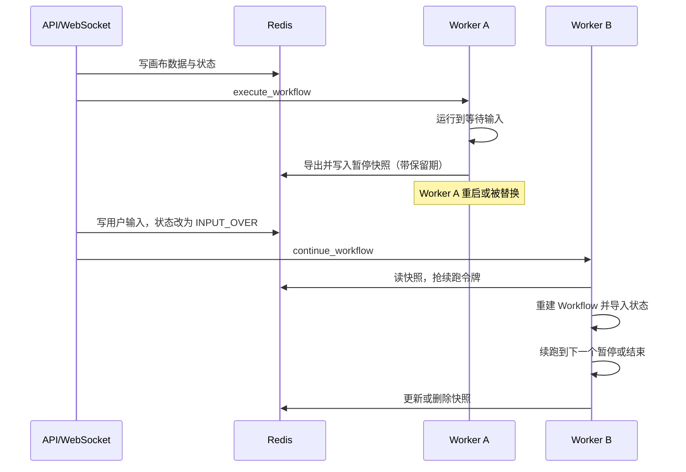

# Design: 工作流暂停态持久化

> **本文档定位 — 现状快照（Why this How）**
>
> `spec.md` 回答做什么；本文回答为什么这么实现；`tasks.md` 是流水账。实现变化时覆盖更新本文，只留今天的状态。

**状态**：草稿，待用户确认（2026-11-25）。**对应 spec**：[spec.md](./spec.md)（2026-11-25 用户已确认）。

---

## 1. 目标与非目标

**目标**：工作流停在“等待用户输入”时，把续跑所需的状态存进 Redis；任何 Worker 都能据此重建并续跑；结束、停止、过期后自动清理。

**非目标**：不恢复运行中被打断的工作流；不做每步检查点与节点重试；不迁移升级前已暂停的会话；不改节点行为、校验规则、事件格式。

---

## 2. 关键约束

| 约束 | 来源 | 对设计的影响 |
|---|---|---|
| Celery 工作流任务走同步路径 `workflow.run()` | `worker/workflow/tasks.py`、`workflow/graph/workflow.py:68-84` | 持久化组件必须有同步实现，不能依赖事件循环 |
| 暂停对象在进程字典 `_global_workflow` 中，`save_workflow_object` 已被注释且没有对应实现 | `tasks.py:36`、`:58` | 没有可复用的现成保存函数，需新写 |
| 画布数据与事件在 Redis 的存活期是 `timeout × 60 + 60` 秒（默认约 12 小时） | `redis_callback.py:90` | 暂停超过 12 小时后画布数据已过期，续跑要另存一份并单独设保留期（见决策 4） |
| 工作流图由画布数据确定性构建 | `graph_engine.py:build_nodes` | 图结构不必持久化，重建即可 |
| LangGraph 检查点为 `MemorySaver`，线程号固定为 `"1"`；依赖 `langgraph>=1.2,<2.0` | `graph_engine.py`、`pyproject.toml:43` | 可导出导入检查点，并用版本范围加兼容测试兜底 |
| 多租户由 ContextVar 注入，Redis 键须带租户 | constitution C3 | 键名含租户号，续跑时校验 |
| 新错误码在工作流模块段登记 | constitution C5 | 拟用 10544 至 10546（落地前核对占用） |
| 日志不得输出暂停态内容 | spec AC-14 | 序列化与恢复代码只记长度与键名 |

---

## 3. 方案对比与选定

### 决策 1：怎么保存状态

| 方案 | 做法 | 问题 |
|---|---|---|
| A | 全程用 Redis 检查点：每一步都写 Redis | 所有工作流（含从不暂停的）都增加写入；要写一个同步的检查点实现 |
| **B（选定）** | 运行中仍用内存检查点；**只在暂停那一刻**把最新检查点、变量池、节点计数导出写入 Redis；续跑时重建工作流并导入 | 依赖检查点保存器的公共接口 `get_tuple`、`put`、`put_writes`，需兼容测试 |
| C | 续跑时按输入重放重新执行 | LLM 调用、工具副作用会重复，结果不一致，否决 |
| D | 把整个 `Workflow` 对象序列化（pickle） | 节点持有连接、客户端等不可序列化对象，且反序列化有安全风险，否决 |

**选 B 的原因**：对不暂停的运行零开销；暂停点只有一种，导出一次即可；不依赖同步事件循环。**何时推翻**：若 langgraph 升级改变上述公共接口的语义，改为方案 A 的同步 Redis 检查点。

### 决策 2：保存哪些内容

暂停时写入一份快照，包含：
1. 检查点：只存最新一份检查点及其待写入，通过保存器的公共接口取出（`get_tuple`），用 LangGraph 自带序列化转为字节后再编码，不用 pickle；续跑时用 `put`、`put_writes` 写回。不读取 `MemorySaver` 的内部存储结构，所以对 langgraph 小版本升级更稳。
2. 变量池 `graph_state.variables_pool` 与对话历史消息（用同一序列化器）。
3. 各节点的 `current_step`（步数计数）。重建后计数归零，会让带循环的流程多跑，必须带过去。
4. 画布数据的副本（决策 4）。
5. 元信息：快照格式版本、`langgraph` 版本、租户号、工作流号、暂停的节点号、创建时间。

不保存：节点实例、回调对象、模型客户端、连接——这些续跑时按任务参数重建。

**暂停时序列化失败**（变量里有不可序列化的值）：不静默丢失，会话置为失败并给出可读原因（对应 spec 边界情况）。

### 决策 3：怎么续跑

续跑任务拿不到内存里的对象时，不再失败，而是：读快照、校验租户与工作流、用画布副本重建 `Workflow`（构造参数与首次运行一致）、导入检查点与变量池、恢复节点计数，再走原有的 `_validate_resume_input`、`handle_input`、`_run(None)`。成功暂停后仍把对象放进内存字典作为热缓存，命中则不重建。

### 决策 4：保留期与画布副本

现有画布数据键的存活期（约 12 小时）远短于 spec 要求的 7 天。快照里**自带一份画布副本**，并以独立的保留期存活。新增配置项 `workflow.pause_retention_seconds`，默认 604800（7 天）。**待你确认**：现有 `workflow.timeout`（默认 720 分钟）的注释写的是“多久没收到用户输入就终止”，但代码里只体现在 Redis 键的过期上；7 天会改变这个默认行为，需要确认以新配置项为准。

### 决策 5：并发与幂等（AC-12）

续跑前用 Redis 原子操作抢占“续跑令牌”（`SET NX` 带短过期）：抢到的执行，抢不到的立即返回 10546。成功续跑到下一个暂停点或结束后释放。

### 决策 6：停止（AC-10）

`stop_workflow` 在内存里找不到对象时，现有行为是直接置失败并返回，可以继续用；补上删除快照即可，不需要重建对象。

### 决策 7：路由

保留按会话的一致性哈希路由（对外行为不变），但正确性不再依赖它。是否取消路由属于后续改进，见 §8。

---

## 4. 系统现状（接手必读）

### 4.1 数据流

### 4.2 关键数据结构

- 快照键：`workflow:{unique_id}:pause`，保留期内存活；值为带格式版本号的 JSON，租户号与工作流号写在值里，读取时校验。
- 标记键：`workflow:{unique_id}:pause_meta`，只含暂停时间与到期时间，比快照多存活一天，使保留期后一天内的请求得到“已过期”而不是“找不到”。
- 续跑令牌键：`workflow:{unique_id}:pause_lock`，短期存活，一次只有一个输入能抢到。
- 配置：`workflow.pause_retention_seconds`（新增，默认 604800）。

### 4.3 模块职责

| 模块 | 职责 |
|---|---|
| `workflow/domain/services/pause_state.py`（新增） | 导出、序列化、导入、校验、清理；不依赖 Celery |
| `workflow/graph/graph_engine.py` | 增加“导出运行状态”“导入运行状态”两个方法，内部状态不外泄到服务层 |
| `worker/workflow/tasks.py` | `_judge_workflow_status` 在 INPUT 时调用导出；`_continue_workflow` 取不到对象时调用重建；`stop_workflow` 与结束路径清理快照 |
| `common/errcode/flow.py` | 新增 10544 会话已过期、10545 暂停态无法还原、10546 续跑被并发拒绝 |

---

## 5. 已知坑 / 反直觉事实

1. **画布数据 12 小时就过期**：只存检查点不够，必须自带画布副本。
2. **步数计数在重建后归零**：循环流程会突破 `max_steps`，必须随快照带回。
3. **`save_workflow_object` 没有实现**：被注释的那行指向一个不存在的函数，不是“忘了打开”。
4. **暂停对象永不释放**：现状下如果用户一直不回来，对象留在进程字典里直到进程结束，是内存泄漏；本修复后应在过期清理时一并移出。
5. **控制组实测**：不重启 Worker 时续跑正常；重启后返回 10541“workflow object not found maybe data is expired”（workflow-study 联调，Q6）。
6. **旧代码的数据库结构**：隔离环境的库对应较旧的分支，在 `feat/3.1.0` 上运行需要先升级库结构，集成验证要用新库。

---

## 6. 对外契约与依赖

**对外**：续跑成功时与现状一致；过期返回 10544；无法还原返回 10545；并发拒绝返回 10546（开放 API 与 WebSocket 两处的错误表现保持一致）。新增配置项 `workflow.pause_retention_seconds`。

**依赖**：Redis（已有）；`langgraph>=1.2,<2.0` 的 `MemorySaver` 内部结构；`RedisCallback` 的画布数据与输入键。

---

## 7. 测试与可观测

- **单元**：快照导出导入往返（含变量池、历史、步数）；序列化失败的处理；快照损坏、版本不符。
- **兼容**：对 `MemorySaver` 内部结构的断言测试；langgraph 升级时先红。
- **集成（含 Redis）**：暂停、清空进程内字典、续跑；两个并发输入只有一个执行；停止暂停会话；过期。
- **端到端**：workflow-study 联调脚本 `b1b.py` 的场景（暂停、重启 Worker、续跑），期望从“10541 失败”变为“got: hello”。
- **节点覆盖**：对含 LLM、检索、工具、条件、循环的样例各跑一次暂停重启续跑，确认变量池都能序列化。
- **可观测**：每次导出与恢复记一条日志，只含会话号、字节数、耗时、结果，不含内容。

---

## 8. 后续改进 / 不打算做的事

- 取消按会话的固定 Worker 路由（正确性已不依赖它）。
- 运行中崩溃的恢复与每步检查点（方案 A）。
- 暂停态的管理界面。

---

## 修订历史

| 日期 | 变更 |
|---|---|
| 2026-11-25 | 初稿，待用户确认 |
| 2026-11-25 | 实现偏差（细节级，不改决策）：键名沿用现有 `workflow:{unique_id}:…` 形式，租户号写在值里校验；新增标记键，过期提示窗口为保留期后一天，之后同一会话号等同于未知会话（与现状一致）。 |
| 2026-11-25 | 实现偏差（细节级，不改决策）：检查点改为通过公共接口只导出最新一份，不读 `MemorySaver` 内部存储；新增模块 `workflow/graph/run_state.py`，引擎增加 `export_run_state`、`import_run_state`（见 tasks T002） |
